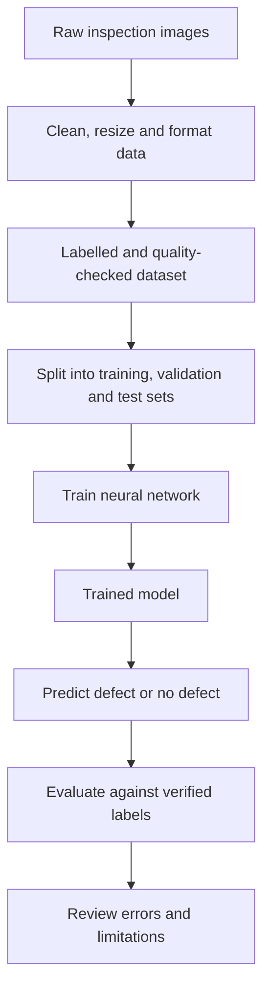

# Mission 1 — Data Behind Deep Learning
## 1. Introduction
Deep learning models learn patterns from examples. Before training a neural network, raw data must be collected, prepared, labelled, and checked for quality. Poorly prepared data can lead to incorrect predictions even when the model architecture is suitable.

For this mission, I use the example of a semiconductor inspection system that examines images and predicts whether a possible defect is present.

## 2. How Does an Image Become Numerical Data?
A computer represents a digital image as a collection of pixels. Each pixel stores numerical information about the image's colour or brightness.

- **Grayscale image:** Each pixel typically contains one intensity value, commonly from 0 to 255 for an 8-bit image.
- **RGB image:** Each pixel contains three values representing red, green, and blue.
- **Image dimensions:** An RGB image can be represented as a numerical array with dimensions height × width × 3.

For example, a small RGB image with dimensions 32 × 32 has 32 × 32 × 3 = 3,072 numerical values.

A neural network processes these numerical values rather than understanding an image as a human does. During training, it learns patterns that may help distinguish defective images from non-defective ones.

## 3. Data Preparation
Data preparation transforms raw data into a consistent format that a model can process.

Important steps include:
1. **Collection:** Gather representative semiconductor inspection images.
2. **Cleaning:** Identify corrupted images, incorrect records, duplicates, and unusable examples.
3. **Resizing:** Convert images to a consistent size when required by the model.
4. **Formatting:** Convert images into numerical arrays in the format expected by the model.
5. **Normalisation:** Scale pixel values to a suitable range, such as 0–1 instead of 0–255.
6. **Labelling:** Assign the correct target label to each image.
7. **Dataset splitting:** Separate the data into training, validation, and test sets.

Normalisation helps place input values on a suitable scale and can make model training more effective. The chosen transformation must also be applied consistently during prediction.

## 4. Labels and Examples
A **label** is the target answer associated with an example. The input is what the model receives, while the label is the answer it learns to predict in supervised learning.

For semiconductor inspection, a simple labelled dataset could contain:
| Image example | Label |
|---|---|
| Image showing a confirmed defect | Defect |
| Image showing no confirmed defect | No defect |
| Image containing a crack confirmed by inspection | Defect |

The labels must be based on reliable inspection or expert review. If a defective image is incorrectly labelled as “No defect,” the model may learn a misleading pattern.

Labels may also be more detailed than two classes. For example, a dataset could classify scratches, cracks, contamination, and other defect categories separately.

## 5. Data Quality
Data quality affects how well a neural network can learn useful patterns.

Common data-quality problems include:

- **Incorrect labels:** The model receives the wrong target answer and may learn incorrect associations.
- **Duplicate images:** Repeated or near-identical images can make the model appear more accurate than it really is, especially if duplicates appear in different dataset splits.
- **Noisy or corrupted images:** Image artifacts, blur, or inconsistent lighting may hide important defect features.
- **Missing examples:** Rare but important defect types may be absent from the dataset.
- **Inconsistent capture conditions:** Different cameras, magnification, lighting, or inspection procedures can introduce variations unrelated to the defect itself.

These problems should be investigated before training. Data cleaning must also be careful not to remove genuine defects simply because they look unusual.

## 6. Representativeness and Class Imbalance
A dataset should represent the range of examples the model is expected to encounter in practice.

Suppose a dataset contains 9,500 images labelled “No defect” and only 500 labelled “Defect.” This is a class imbalance because one category contains far more examples than the other.

A model could achieve apparently high accuracy by predicting “No defect” for most images, while still missing many real defects.

Possible approaches include collecting more examples of underrepresented defect categories, using appropriate sampling strategies, applying class weights where suitable, and evaluating each class separately.

The dataset should also represent variations in defect size, shape, lighting, manufacturing conditions, and inspection equipment. A model trained on a narrow range of examples may perform poorly when those conditions change.

## 7. Training, Validation, and Test Splits
The original dataset is commonly divided into three separate subsets.

| Dataset | Purpose | How it is used |
|---|---|---|
| Training set | Teach the model to learn patterns | Used to update model parameters |
| Validation set | Help choose and tune the model | Used during development to compare configurations and monitor generalisation |
| Test set | Estimate final performance on unseen examples | Used for final evaluation after model choices have been made |

A split such as 70% training, 15% validation, and 15% test is one possible starting point, not a universal rule. The appropriate split depends on the dataset size and problem.

The test set should not be used repeatedly to make model-development decisions. Doing so can indirectly influence the model selection process and make the final evaluation less reliable.

Duplicates and closely related images must also be handled carefully. For example, multiple images of the same physical wafer should not automatically be scattered across training and test sets if that would allow the model to recognise familiar wafer-specific patterns. Grouping related examples appropriately can provide a more realistic evaluation.

## 8. Data Preparation Flow Diagram
The following diagram summarises the workflow from raw inspection images to evaluation.

### Explanation of Each Stage
1. **Raw inspection images:** Images are collected from the inspection process.
2. **Data preparation:** Images are checked for quality and converted into a consistent numerical format.
3. **Labelled dataset:** Each usable image receives an appropriate label, and labels are checked for accuracy.
4. **Dataset splitting:** Separate subsets are prepared for training, validation, and final testing.
5. **Training:** The neural network learns patterns from training examples by updating its parameters.
6. **Trained model:** The model contains the parameters learned during training.
7. **Prediction:** A new image is provided to the trained model, which produces a prediction such as “Defect” or “No defect.”
8. **Evaluation:** Predictions are compared with verified labels to measure performance on unseen examples.
9. **Review:** Errors are investigated to understand limitations and identify improvements.

## 9. Data-Related Problems That Can Affect the Final Prediction
### Problem 1: Incorrect Labels
Suppose several images containing cracks are incorrectly labelled as “No defect.” During training, the model receives contradictory examples and may learn that crack-like patterns do not indicate defects.

**Possible effect:** The model may miss actual defects during inspection.

**Possible mitigation:** Verify labels using reliable inspection records or expert review, investigate disagreements, and correct confirmed labelling errors.

### Problem 2: Unrepresentative or Imbalanced Data
Suppose the training dataset contains many examples of common defects but very few examples of a rare, serious defect. The model may learn the common categories well but fail to recognise the rare defect.

**Possible effect:** The system may report good overall accuracy while missing important defects.

**Possible mitigation:** Collect more representative examples where possible, inspect per-class performance, and evaluate the model on a test set that adequately represents the intended use.

## 10. Conclusion
Data preparation is a fundamental part of deep learning, not merely a preliminary step. Images must be represented numerically, cleaned, labelled, and divided appropriately before a model can learn and be evaluated.

For semiconductor inspection, reliable labels, representative data, and an independent test set are essential for assessing whether predictions are useful on unseen images. Even a well-trained model can fail when the data contains errors or differs from the conditions encountered in practice.

## References
1. Google Machine Learning Crash Course — [Working with Numerical Data](https://developers.google.com/machine-learning/crash-course/numerical-data)
2. Google Machine Learning Crash Course — [Dividing the Original Dataset](https://developers.google.com/machine-learning/crash-course/overfitting/dividing-datasets)
3. Google Machine Learning Crash Course — [Overfitting and Generalisation](https://developers.google.com/machine-learning/crash-course/overfitting/overfitting)
