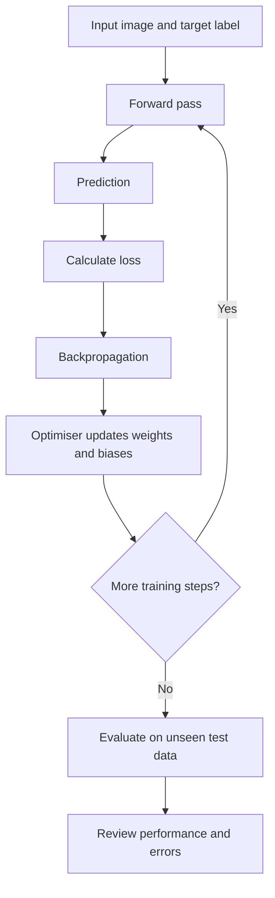

# Mission 4 — How Does a Neural Network Learn?

## 1. Introduction
A neural network learns by comparing its predictions with the correct answers and adjusting its parameters to reduce prediction errors.

For this example, consider a semiconductor inspection system that classifies images as **Defect** or **No defect**. The model learns from labelled inspection images and is later evaluated on images it has not seen during training.

## 2. Forward Pass

The forward pass is the process of sending input data through a neural network to produce a prediction.

For semiconductor inspection:

1. An inspection image is converted into numerical pixel values.
2. The values enter the input layer.
3. Hidden-layer neurons process the information using weights, biases, and activation functions.
4. The output layer produces predictions, such as the probabilities of “Defect” and “No defect.”

The forward pass produces a prediction, but it does not by itself tell us whether that prediction is correct.

## 3. Prediction and Loss Function
A **prediction** is the output produced by the model. A **target** is the correct label or answer associated with the training example.

A loss function measures how different the prediction is from the target. During training, the network uses this error information to improve its parameters.
For example:

- Input: A semiconductor image containing a confirmed scratch.
- Target: Defect.
- Prediction: No defect.
- Result: The prediction is incorrect, so the loss indicates an error that the training process can use to adjust the model.

The exact loss value depends on the chosen loss function and the model's output. The example above illustrates the process rather than reporting an actual experiment.

## 4. Backpropagation
Backpropagation calculates how the loss changes with respect to the network's trainable parameters, such as weights and biases.

In simple terms:
1. The model makes a prediction.
2. The loss function measures the prediction error.
3. Backpropagation calculates information about how the parameters contributed to that error.
4. The optimiser uses this information to update the parameters.

This process helps the network improve its predictions over repeated training steps.

## 5. Optimisation and Parameter Updates
An optimiser uses the gradients calculated during backpropagation to adjust the model's weights and biases.

For example, gradient descent updates parameters in a direction intended to reduce the loss. The learning rate controls the size of each update.

- Updates that are too large can make training unstable.
- Updates that are too small can make learning slow.
- Suitable updates help the model learn patterns from the training data.

Training does not guarantee that every prediction will become correct. The model's performance must be evaluated using appropriate data that was not used to fit its parameters.

## 6. What Is an Epoch?
An **epoch** is one complete pass through the training dataset.

Neural networks usually need multiple training steps and often multiple epochs to learn useful patterns. With each epoch, the optimiser can update the model's parameters based on the training examples.

Training for more epochs does not always improve generalisation. If the model starts memorising details that do not help on new examples, it may overfit.

## 7. Training Versus Inference
| Training | Inference |
|---|---|
| Uses training examples, usually with known target labels in supervised learning. | Uses new input data to produce predictions. |
| Calculates loss and updates weights and biases. | Uses the learned weights and biases to calculate outputs. |
| Repeats optimisation steps over the training data. | Normally does not update the model's parameters. |
| Aims to learn useful patterns from examples. | Applies the trained model to an input. |

For semiconductor inspection, training uses labelled images to learn useful patterns. During inference, a new inspection image is processed by the trained network to produce a prediction.

## 8. Generalisation
**Generalisation** is the ability of a model to make useful predictions on examples beyond those used during training.

A model may perform well on training images but poorly on new images. This can happen when it learns patterns that are specific to the training dataset rather than patterns that remain useful in new situations.

For example, a model might learn to associate a particular lighting condition with a defect because that condition appears frequently in its training images. If the lighting changes, the model may make incorrect predictions.

A separate validation dataset can help compare models and monitor generalisation during development. A test dataset is reserved for the final evaluation after model choices have been made.

## 9. Two Situations to Consider
### Situation A: Incorrect Labels in Training Data

Suppose some images containing scratches are incorrectly labelled as “No defect.”

The network receives misleading target answers during training. It may learn incorrect associations between scratch-like patterns and the labels it is given.

**What this tells us:** Reliable labels and good data quality are important. The training algorithm cannot automatically know that a supplied label is incorrect.

**Possible improvement:** Review questionable labels against reliable inspection records and correct confirmed errors.

### Situation B: Good Training Performance but Poor Performance on New Images

Suppose a model performs very well on its training images but makes many mistakes on previously unseen images.

This indicates that good training performance alone is not enough to establish that the model has learned patterns that generalise.

Possible causes include overfitting, unrepresentative training data, data-quality problems, or differences between training and deployment conditions.

**Possible improvement:** Evaluate on suitable validation and test datasets, inspect errors, and check whether the data represents the conditions in which the model will be used.

## 10. Training-Process Flowchart
These situations show that data quality affects what a neural network learns, while evaluation on unseen data helps determine whether the learned patterns generalise. Incorrect labels can mislead training, and strong training performance alone cannot prove that a model will work reliably in practice.

### Explanation of the Flowchart

1. **Input and target:** Provide a training image and its verified label.
2. **Forward pass:** Process the input through the network.
3. **Prediction:** Produce the model's output.
4. **Loss calculation:** Compare the prediction with the target.
5. **Backpropagation:** Calculate gradients that indicate how the trainable parameters affect the loss.
6. **Parameter updates:** Use an optimiser to update weights and biases.
7. **Repeated training:** Continue training steps and epochs as appropriate.
8. **Evaluation:** Assess the trained model on separate, unseen test data.
9. **Error review:** Analyse mistakes and limitations before considering practical use.

## 11. Conclusion

A neural network learns through repeated forward passes, loss calculation, backpropagation, and parameter updates. An epoch represents one complete pass through the training dataset, while inference uses the trained model to make predictions without normally changing its parameters.

Good training performance does not guarantee good performance on unseen data. Reliable labels, representative datasets, appropriate validation, independent testing, and engineering review are all important when evaluating a potential semiconductor inspection application.

## References
1. Google Machine Learning Crash Course — [Neural Networks](https://developers.google.com/machine-learning/crash-course/neural-networks)
2. Google Machine Learning Crash Course — [Overfitting](https://developers.google.com/machine-learning/crash-course/overfitting/overfitting)
3. Google Machine Learning Crash Course — [Classification](https://developers.google.com/machine-learning/crash-course/classification)
