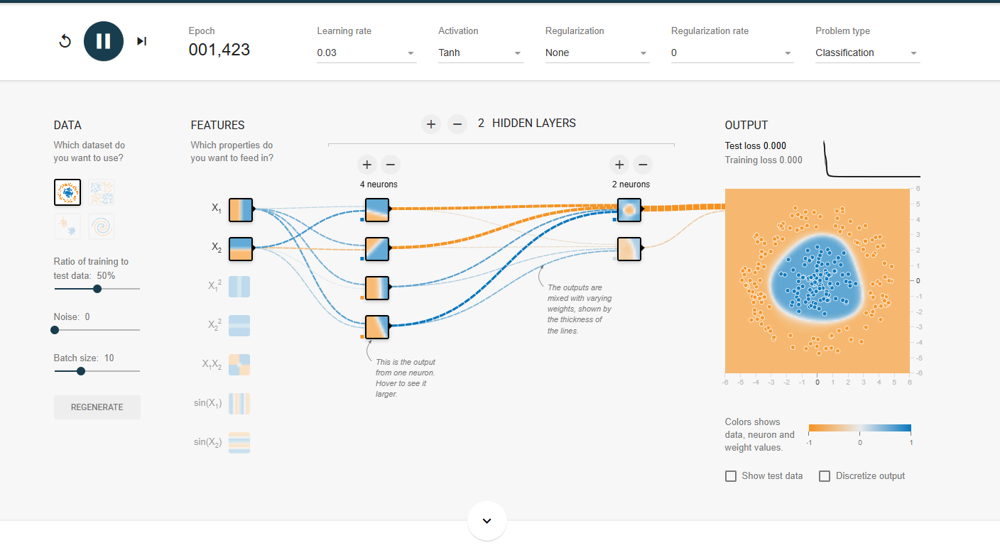
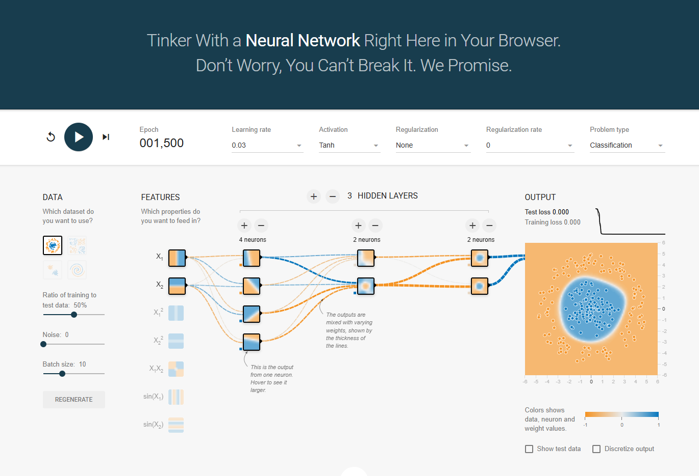

# Mission 5 — TensorFlow Playground Experiment

## 1. Objective

The objective was to investigate whether increasing neural network complexity always improves classification performance.

I used TensorFlow Playground to compare a baseline network with two hidden layers against a modified network with three hidden layers.

## 2. Experiment A — Baseline Configuration

- **Problem type:** Classification
- **Dataset:** Circle
- **Hidden layers:** 2
- **Neurons per layer:** 4 and 2
- **Activation function:** Tanh
- **Learning rate:** 0.03
- **Regularization:** None
- **Noise:** 0
- **Training-to-test ratio:** 50%

### Observations

At epoch 1,423, the displayed training loss was 0.000 and the displayed test loss was 0.000. The decision boundary separated the central blue points from the outer orange points.

The baseline network learned the classification pattern successfully.

## 3. Experiment B — Modified Configuration

I added one hidden layer while keeping the other settings unchanged.

- **Problem type:** Classification
- **Dataset:** Circle
- **Hidden layers:** 3
- **Neurons per layer:** 4, 2, and 2
- **Activation function:** Tanh
- **Learning rate:** 0.03
- **Regularization:** None
- **Noise:** 0
- **Training-to-test ratio:** 50%

### Observations

At epoch 3,082, the displayed training loss was 0.000 and the displayed test loss was 0.001. The decision boundary separated the inner blue points from the outer orange points well.

The added hidden layer did not produce a noticeable improvement in the displayed test loss compared with the baseline.

## 4. Comparison

| Measurement | Experiment A | Experiment B |
|---|---:|---:|
| Hidden layers | 2 | 3 |
| Neurons per layer | 4, 2 | 4, 2, 2 |
| Epoch | 1,423 | 3,082 |
| Training loss | 0.000 | 0.000 |
| Test loss | 0.000 | 0.001 |

The displayed loss values are rounded by the tool. The experiments also stopped at different epochs, so this is an observation from the two runs rather than a controlled proof that one architecture is always better.

## 5. Answers to the Investigation Questions

### What changed when I modified the network?

I added a third hidden layer containing two neurons. The network became more complex, but the dataset and the other displayed settings remained unchanged.

### Did the more complex network always perform better?

No. In these runs, the baseline displayed a test loss of 0.000, while the modified network displayed a test loss of 0.001. Both learned a good decision boundary.

### What did I observe about model complexity?

A network with more hidden layers can learn complex patterns, but increasing its size does not guarantee better results. A simpler model can be sufficient when the classification problem is relatively easy.

### Why should training performance not be the only measure of success?

Training loss measures performance on training examples. Test loss provides evidence about performance on separate examples. A model that performs well on training data may still generalise poorly to new data.

### How is this experiment different from semiconductor inspection?

The Playground uses a simple synthetic Circle dataset with two-dimensional points. Real semiconductor inspection involves images, image quality issues, different defect types, and manufacturing variations. Results on the Playground do not establish that the same architecture would work well for semiconductor inspection.

### What additional evidence would be needed for practical use?

A practical application would require representative labelled inspection images, reliable evaluation on unseen data, testing under different inspection conditions, analysis of false positives and false negatives, and engineering review.

## 6. Conclusion

The experiment showed that both network configurations learned the Circle classification pattern. Adding a hidden layer did not improve the displayed test loss in these runs.

The main lesson is that a more complex neural network is not automatically better. Model selection should be based on suitable evaluation data, the problem's requirements, and the consequences of incorrect predictions.

## 7. Evidence

### Experiment A — Baseline

### Experiment B — Three hidden layers

